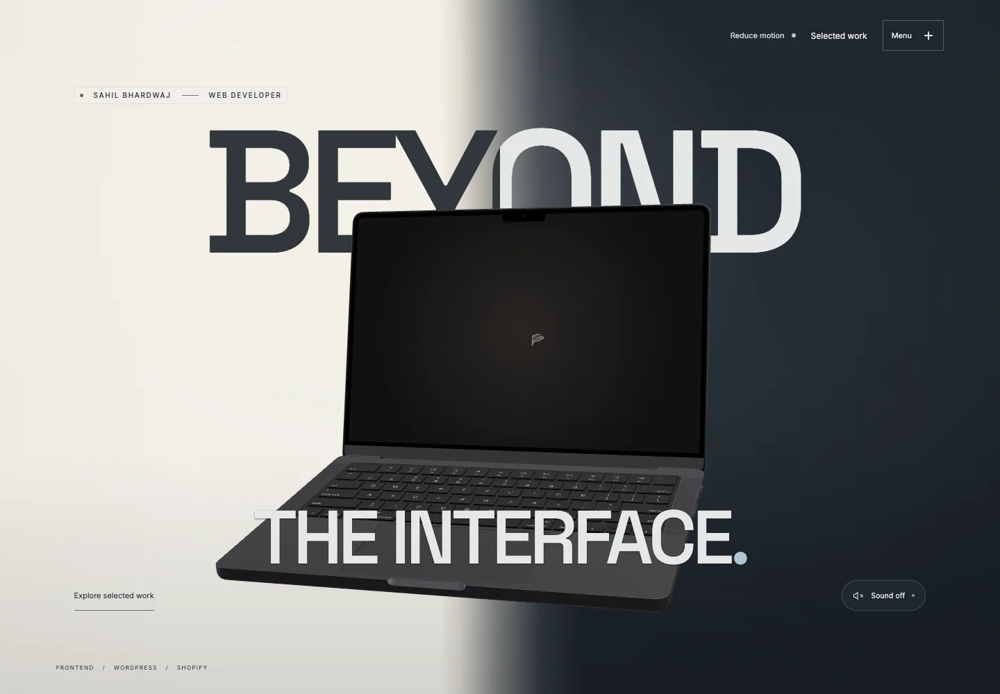
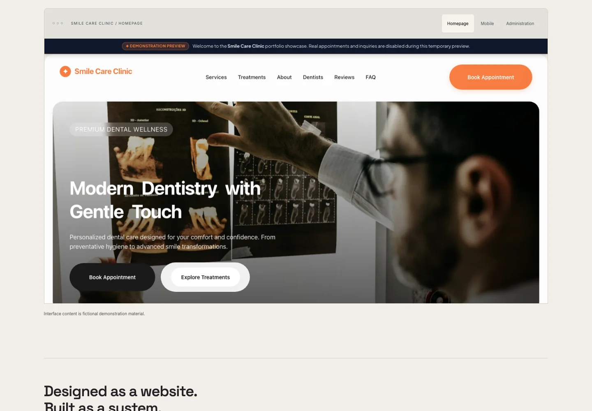
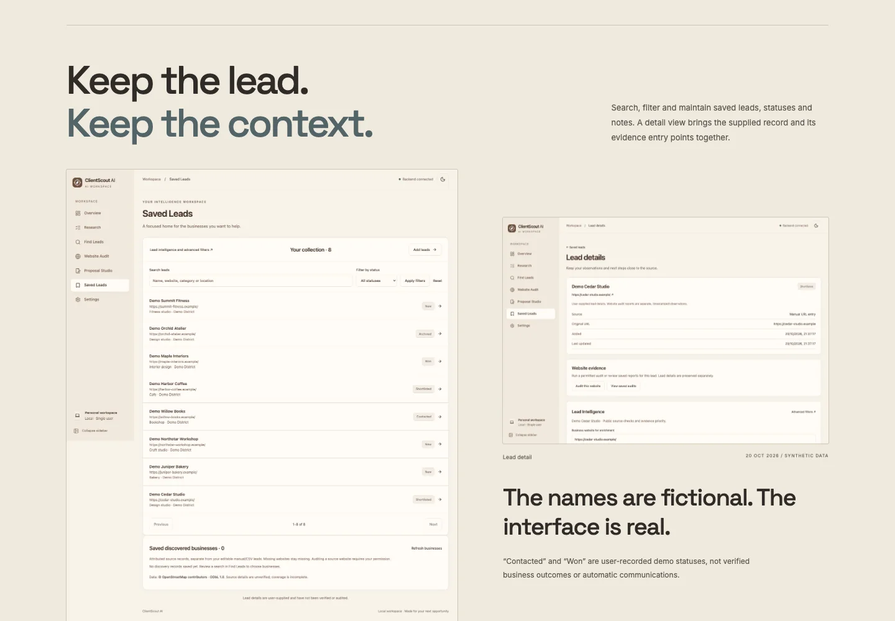
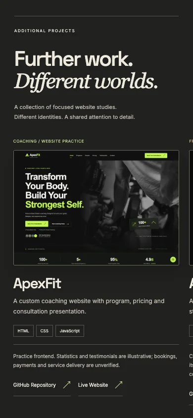
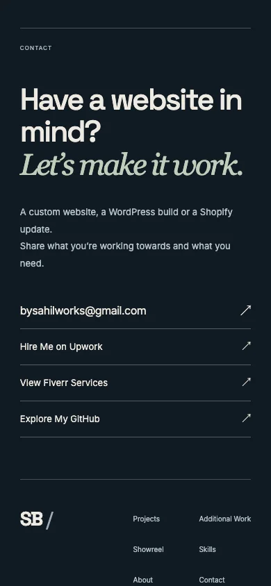

# OG Portfolio

### Beyond the interface.

A cinematic web developer portfolio by **Sahil Bhardwaj**, bringing custom frontends, WordPress work and Shopify customization into one continuous experience. A 3D laptop introduces the work; scroll-led project chapters reveal the interfaces, implementation and honest scope behind each build.

Warm ivory, graphite and project-specific palettes give each showcase its own identity, while a swipeable collection and an original commercial bring the experience together.

**Status: launch-ready · not yet publicly deployed.** Desktop and lightweight mobile polish are approved. Vercel configuration is prepared; the production hostname and public deployment remain pending. No live portfolio URL is claimed.



[Explore the experience](#features) · [View the work](#selected-work) · [Run locally](#local-setup) · [Deployment](#vercel-deployment) · [Contact](#contact)

## Features

- **Cinematic hero.** An original 3D laptop, layered typography, a video-textured display and a reversible screen-to-project handoff. Optional ambient sound starts only after the visitor enables it.
- **Four featured showcases.** Smile Care Clinic, SIX&7 Shopify, Ember & Oak and ClientScout AI combine genuine captures with project context, technologies and implementation details.
- **Additional projects gallery.** ApexFit, Aroma / Noctis, AETHER and ApexForm support touch swiping, desktop dragging, keyboard navigation and explicit project links.
- **Commercial screening room.** An original 41-second film with native playback controls, an accessible transcript, user-initiated audio and coordinated soundtrack behavior.
- **A complete introduction.** Skills, About, direct email and approved professional profiles, followed by functional navigation and a concise footer.
- **Responsive presentation.** Mobile and tablet use inline project sections and touch-friendly controls. Desktop retains the approved cinematic transitions.
- **Accessible alternatives.** System and manual reduced-motion settings, static gallery layouts, keyboard controls, focus indicators, descriptive image text and WebGL/media fallbacks.

## Selected work

| Project | Focus | Scope |
| --- | --- | --- |
| Smile Care Clinic | WordPress, PHP, Gutenberg and JavaScript | Practice project; fictional clinic content and simulated public submissions. |
| SIX&7 Shopify | Liquid, Dawn and Shopify theme customization | Practice storefront; dated draft-preview captures and a password-protected storefront link. |
| Ember & Oak | Responsive restaurant interface and visual storytelling | Fictional restaurant concept; booking and form delivery are unverified. |
| ClientScout AI | React interface and Python/FastAPI application workflow | In development; synthetic records, local snapshots and explicitly qualified integrations. |

The additional collection presents four website studies. **ApexFit is the only project with a public “Live Website” action.** Other projects retain source links; the SIX&7 storefront is clearly labeled password-protected. Case-study technology labels describe those projects, rather than dependencies of this portfolio.

## Screenshots

These are genuine captures from the production build. The WebP documentation copies preserve the captured composition; they are separate from runtime project assets.

| Smile Care Clinic | ClientScout AI |
| --- | --- |
|  |  |

| Mobile collection | Mobile contact |
| --- | --- |
|  |  |

[Capture details and image sizes](docs/screenshots/README.md)

## Tech stack

| Area | Used in this repository |
| --- | --- |
| Application | React 19, TypeScript |
| Build | Vite 7, npm lockfile |
| 3D | Three.js, React Three Fiber, GLTFLoader |
| Motion | GSAP and ScrollTrigger, CSS transforms and transitions |
| Media | Native HTML video/audio, Three.js VideoTexture |
| Styling | CSS, locally bundled Inter and Space Grotesk variable fonts |
| Browser checks | Playwright Core with installed Google Chrome |

The portfolio is a static frontend. It needs no backend, database, API key or contact-form service.

## Local setup

Use **Node.js 24 LTS** and npm. The current checkout was built with Node.js 24.19.0 and npm 11.17.0.

```sh
git clone --branch feature/phase-3-cinematic-projects https://github.com/sahilbhardwaj037037-sys/og-portfolio.git
cd og-portfolio
npm ci
npm run dev
```

Open `http://127.0.0.1:5173/`. The repository root is the app root; the local directory name `prototype` is not an extra folder inside the GitHub checkout.

```sh
npm run build     # TypeScript checks and Vite production output → dist/
npm run preview   # Serve dist/ at http://127.0.0.1:5174/
```

No environment variable is needed for local development. Copy `.env.example` only if you want to configure deployment metadata. `VITE_SITE_URL` must contain the actual public base URL when the production hostname is known; it generates canonical/OG URLs, absolute social images, robots sitemap references and a one-page sitemap. Leave it unset until then. `VITE_` values are public build-time configuration, never secrets.

### Project structure

```text
src/
  main.tsx                      Application composition and hero handoff
  scene.tsx                     Laptop rendering and screen presentation
  *Story.tsx                    Featured project showcases
  AdditionalProjectsGallery.tsx Swipe/drag collection
  CommercialShowreel.tsx        Native film and playback lifecycle
  PortfolioClosing.tsx          Skills, About, Contact and footer
  SiteNavigation.tsx            Accessible navigation dialog
  contact.ts                    Approved contact destinations
  *.css                         Scoped layout, themes and responsive styles
public/
  media/                        Required models, films, audio and project captures
  social-preview.png            Social sharing image
docs/
  screenshots/                  Curated README captures
  asset-integrity.json          Runtime asset checksums
  LAUNCH-DEPLOYMENT.md           Vercel release instructions
qa/                             Browser regression scripts; generated evidence ignored
licenses/                       Font notices and media/capture provenance
vercel.json                     Static Vite build and asset cache settings
```

## Verification

Build first, start `npm run preview`, then run focused checks in another terminal:

```sh
npm run qa:assets
node qa/production-smoke.mjs
OG_QA_URL=http://127.0.0.1:5174 npm run qa:phase3
OG_QA_URL=http://127.0.0.1:5174 node qa/clientscout-gallery-check.mjs
OG_QA_URL=http://127.0.0.1:5174 npm run qa:showreel
```

Browser scripts currently use Google Chrome at `/Applications/Google Chrome.app/Contents/MacOS/Google Chrome`. Playwright Core does not download a browser. Adjust the executable path for a different operating system.

Desktop and 320px, 375px, 390px and 768px layouts have been checked in local Chrome with touch emulation. This is not a claim of physical-device or Safari/iOS certification. Generated QA screenshots, recordings, logs and local results are excluded from Git; only the curated documentation screenshots are included.

## Vercel deployment

Deployment is prepared, **not performed**. The app uses native `#section` navigation within one document, so it does not need a catch-all SPA rewrite. Static images, fonts, the model and both videos are served directly from `dist`; missing media must remain genuine 404s.

| Setting | Value |
| --- | --- |
| Framework | Vite |
| Root directory | Repository root (`.`) |
| Install command | `npm ci` |
| Build command | `npm run build` |
| Output directory | `dist` |
| Node.js | 24.x |
| Release branch | `feature/phase-3-cinematic-projects` |
| Production metadata | `VITE_SITE_URL` set to the confirmed production base URL |

The build includes approximately **54.11 MB** of output. The commercial is **5.75 MB, 41 seconds, 1920×1080 H.264/AAC**; the separate laptop-screen video is 23.46 MB. All required production media remain unchanged. Vercel's documented CLI source-upload limits are 100 MB for Hobby and 1 GB for Pro; this source/build is below those size thresholds. These are upload limits, not a promise about account quotas or real-world bandwidth. See [Vercel limits](https://vercel.com/docs/limits#static-file-uploads).

After release approval, link the intended Vercel project, confirm its hostname, set `VITE_SITE_URL`, select the release branch and deploy. Verify the public site before adding its final URL here. The [deployment guide](docs/LAUNCH-DEPLOYMENT.md) provides the exact release sequence and post-deployment checks.

## Contact

- **Email:** [bysahilworks@gmail.com](mailto:bysahilworks@gmail.com)
- **Upwork:** [Hire Me on Upwork](https://www.upwork.com/freelancers/~015b6e376493c182fd)
- **Fiverr:** [View Fiverr Services](https://www.fiverr.com/s/jyyw1vG)
- **GitHub:** [Explore My GitHub](https://github.com/sahilbhardwaj037037-sys)

## Assets and usage

Runtime assets are included for a complete build and verified against [the checksum manifest](docs/asset-integrity.json). Documentation images are optimized copies of genuine portfolio screenshots, not replacement project imagery.

Font licenses and project/media provenance remain in [licenses](licenses/). This repository does not grant a blanket license to the source, model, supplied films, soundtrack or third-party imagery. Refer to those notices before reusing assets. No client results, public integrations or production services are implied by the practice-project captures.
