# OG Portfolio — Phase 3A discovery and proposed cinematic journey

Prepared October 23, 2026. **Historical Phase 3A planning record.** The user subsequently approved its architecture and the six Shopify captures for Phase 3B only. See [the local Phase 3B implementation review](PHASE-3B-REVIEW.md). Findings and initial clean-tree statements below describe the pre-implementation snapshot; later projects still require separate approvals.

The recommended direction is a sequence of three spatial passages between readable project chapters. Each passage uses genuine screenshots as planes in CSS perspective space, choreographed by the existing GSAP/ScrollTrigger system. The laptop keeps its existing React Three Fiber scene and camera. The project passages add no WebGL canvas, virtual scroll controller, soundtrack, or generated project imagery.

**1. Checkpoint and scope**

The initial working tree was clean on `feature/phase-2.2-living-environment`. Created `feature/phase-3-cinematic-projects` directly from approved commit `893bd29a46366b18e008de9149c4161f959e34c9`. Local `main` remains `4b0992cc3c8b0d74a6337d8cb7d6e4b9fff6822d`. The Phase 2.2 branch remains the rollback point. No application code, original asset, dependency, remote branch, or other repository has been modified. This branch currently adds only this plan and its inventory document.

Discovery caches and unchanged screenshot copies are outside the prototype repository at `../../discovery/phase-3a/`. They are evidence for review, not runtime media. The original sibling ClientScout repository was inspected read-only; its pending development files were left untouched. No project backend, Shopify Admin session, external provider, reservation form, checkout, or AI service was exercised.

**2. Existing architecture and boundaries to preserve**

| Owner | Current behavior | Phase 3 boundary |
| --- | --- | --- |
| `src/main.tsx` | Hero pin spans 2.15 viewport heights; scrub 0.22; refresh priority 1. Owns projected-screen/DOM overlay and manual motion preference | Retain the hero controller, its geometry, IDs and existing skip-to-work behavior. Append new project siblings after Smile Care |
| `src/scene.tsx` | One demand-rendered R3F canvas inside the hero, perspective camera with 34° FOV, original display mesh, runtime Apple-logo concealment, capped DPR | Do not relocate or reuse its camera for later projects. Its projection math, model, materials and UVs stay unchanged |
| `src/screenVideo.ts` | Independent muted looping VideoTexture; decoded-frame readiness; hero visibility/reduced-motion lifecycle | No new video or texture work for the project passages |
| `src/SmileCareStory.tsx` | Desktop CSS perspective imagery with its own ScrollTrigger progress; sticky visual rail; reversible frontend/mobile/admin poses | Preserve this component and timeline. Append the new exit after the existing gallery and implementation notes |
| `src/refinement.css` | Balanced static desktop rows when `.has-depth` is absent; stacked small-screen story | Keep the approved reduced-motion correction. New styles must be scoped to new components |
| `src/useLivingEnvironment.ts`, `HeroSound.tsx`, `heroAudio.ts` | Ref-based hero environment and separate opt-in sound lifecycle | Remain hero-only; later project themes must not alter the root hero tokens or audio eligibility |
| `src/projectThemes.ts` | Four approved token palettes already registered; only Smile Care mounted | Reuse section-scoped palettes for new showcases |

There is no router or smooth-scroll library to replace. Native scrolling and ScrollTrigger already coordinate the experience. A later pin changes downstream measurements, so new contexts must initialize in document order and refresh after layout/font/image readiness. Do not nest a new pin inside the existing hero pin or animate the pinned shell itself. These choices follow [ScrollTrigger's pin and refresh guidance](https://gsap.com/docs/v3/Plugins/ScrollTrigger/).

**3. Asset inventory and evidence**

[Machine-readable inventory](phase3a-asset-inventory.json) records all 38 screenshots: source repository, exact revision, path, dimensions, file size and SHA-256. The 25 screenshots from cached default-branch trees were retrieved at pinned revisions and checked against their Git blob hashes. The additional 13 current ClientScout files were copied unchanged from the original project and compared byte-for-byte with its committed blobs. All six Shopify files also match their screenshot manifest SHA-256 values. Combined evidence copies occupy 4,674,211 bytes; the implementation should ship only selected images.

The three default-branch revisions below were checked with `git ls-remote` on October 23 and match the earlier discovery snapshots. ClientScout's newer feature branch was checked separately.

| Project | Verified source revision | Available genuine imagery | Proposed selection |
| --- | --- | --- | --- |
| Smile Care | Approved portfolio checkpoint `893bd29` | Existing `smile-desktop.png` 1440×757, `smile-mobile.png` 500×701, `smile-admin.png` 1440×757 | Keep all current content; existing homepage capture supplies a labeled closing plane |
| SIX&7 Shopify | [`six7-shopify-store`, `0d3c1ad98d849135906743a5e57b8e63edcffdc0`](https://github.com/sahilbhardwaj037037-sys/six7-shopify-store/tree/0d3c1ad98d849135906743a5e57b8e63edcffdc0) | Six WebPs, 192,184 bytes total: desktop hero 1440×900; collection and product 1440×1000; mobile home, collection and product 390×844 | Use this six-image set, with dates and preview status. All six visually inspected |
| Ember & Oak | [`Ember-Oak`, `bf30d00a95273e9177f06fef3da0b9415467de24`](https://github.com/sahilbhardwaj037037-sys/Ember-Oak/tree/bf30d00a95273e9177f06fef3da0b9415467de24) | Eleven JPGs, 1,482,336 bytes total: hero, menu, gallery, reservation, full page, tablet, mobile/320px and navigation. Eleven underlying restaurant JPEG paths also exist in the source tree | Hero 1440×900, gallery 1440×923, menu 1440×959, plus mobile capture. These three desktop views visually inspected; other files inventoried |
| ClientScout, current portfolio set | [`feature/checkpoint-5`, `8ceb24402d5518fc532fc5b32d848edbc9040538`](https://github.com/sahilbhardwaj037037-sys/clientscout-ai/tree/8ceb24402d5518fc532fc5b32d848edbc9040538) | Thirteen JPGs, 1,484,363 bytes total: light/dark dashboard, leads, detail, import, audit, assessment, discovery, research, settings, tablet and mobile/navigation | Prefer light dashboard 1440×1758, leads 1440×1667, detail 1440×1000, audit 1440×1127, and mobile 390×844. Dashboard, leads and research visually inspected |
| ClientScout, historical set | [`main`, `ba50d79bcd5713d83368648fa01a47d4b4d20a73`](https://github.com/sahilbhardwaj037037-sys/clientscout-ai/tree/ba50d79bcd5713d83368648fa01a47d4b4d20a73) | Eight PNGs, 1,515,328 bytes, from foundation/Checkpoint 2/3A | Retain as provenance; superseded for the leading dashboard visual. Older overview visibly contains unavailable functionality |

Representative originals for review: [SIX&7 hero](../../discovery/phase-3a/six7-shopify-store/desktop-home-hero.webp), [SIX&7 product](../../discovery/phase-3a/six7-shopify-store/desktop-product.webp), [Ember hero](../../discovery/phase-3a/Ember-Oak/desktop-hero.jpg), [Ember gallery](../../discovery/phase-3a/Ember-Oak/desktop-gallery.jpg), [current ClientScout dashboard](../../discovery/phase-3a/clientscout-ai-current/portfolio-dashboard-desktop-light.jpg), [current ClientScout leads](../../discovery/phase-3a/clientscout-ai-current/portfolio-leads-desktop.jpg). These local links require this workspace; inventory source URLs remain useful in another checkout.

**Source and presentation qualifications**

SIX&7 is a Liquid/JSON/CSS/vanilla-JavaScript customization of Shopify Dawn 16 with editor-configurable sections and native commerce presentation. The screenshot manifest records October 17 captures and an October 20 documentation review. The desktop hero is the approved Draft preview; internal-page and mobile images predate the final homepage motion refinement. The storefront still redirects anonymous visitors to `/password` on October 23. Source references confirm section schemas and custom presentation; they do not prove present checkout, payment, fulfillment or store publication state. The separate `Six-_7` Next.js/Prisma application and the historical `portfolio-delivery/` package must not supply visuals or engineering claims to this Shopify showcase.

Ember & Oak is a fictional restaurant frontend built with HTML/CSS/vanilla JavaScript: category menu, responsive navigation, photographic storytelling and reservation-request validation. Its [documented Pages demo](https://sahilbhardwaj037037-sys.github.io/Ember-Oak/) returned HTTP 200 with the expected page title on October 23. That verifies the entry page, not every feature or Formspree delivery. The concept's reviews, restaurant identity and contact details are not client results. Existing photo source/rights records remain incomplete; do not expand into an independently reused restaurant photography library without provenance confirmation.

ClientScout is an evolving local, single-user application with React/TypeScript/Vite and FastAPI/SQLAlchemy/Alembic/SQLite. Source includes leads/imports, bounded audits/discovery, evidence review and human-reviewed drafts. The newer README distinguishes published Checkpoint 5.1 foundations from pending local 5.2 development. Its portfolio JPGs are genuine renders of that working tree with eight fictional `Demo` records on reserved `.example` domains, a temporary database and disabled/blocked providers. Caption this as a development snapshot with synthetic demo records. Do not turn counts or user-entered “Won” states into business outcomes. Do not claim production SaaS hosting, live provider acceptance, automatic outreach, scheduling or complete research automation. Source-project test counts are documented historical results; its tests were not rerun here.

Logos are visible in genuine captures; Ember's text wordmark is also in its HTML and ClientScout has a compass mark in its UI. No separate approved high-resolution logo pack or product cutout pack is present in the portfolio. Use portfolio typography for project names and keep actual branding inside screenshots. Extracting/redrawing brand marks or isolating a shoe is unnecessary for Phase 3B and is not proposed.

**4. Missing assets and what they affect**

| Gap | Consequence / proposed handling |
| --- | --- |
| SIX&7 full current homepage, final-motion recording, cart, tablet and mobile-navigation captures | Not required for a complete six-image case study. Do not depict these states or simulate an active Shopify store. Request an authorized fresh capture only if these become part of the approved story |
| Public anonymous SIX&7 preview | Repository link is the primary CTA. If included, label the store link “Password-protected storefront”; never label it an open live demo or publish a password |
| Final approval of screenshot selection and dated captions | This plan proposes the existing original sets; Phase 3A approval approves the Phase 3B selection. No runtime asset has been copied yet |
| Ember underlying photo provenance | Use existing project screenshots for the planned design; resolve attribution/reuse details before separately repurposing original photographs |
| ClientScout hosted demo, current Proposal Studio/Gemini output capture, production feature acceptance | Use the genuine source link, development snapshot labels and existing actual screens. A writer/results narrative needs fresh approved evidence. No private data or generated prospect results |
| Separate project logo/cutout files | Optional, not a blocker; neither is needed to create real spatial depth |

**5. Transition architecture**

Use reusable DOM/CSS 3D passages, each with a stable stage shell and a scoped ScrollTrigger timeline. `perspective` (starting around 1600px), `transform-style: preserve-3d`, `translateZ`, `rotateY` and modest lateral movement create projective depth and foreshortening. A parent world transform provides a virtual dolly. This is actual browser 3D projection of planes, with no claim of WebGL lighting or volumetric geometry. Reopening the hero's R3F scene would require moving its canvas, changing camera ownership and adapting its offscreen scheduling; that creates avoidable risk for the approved screen handoff.

```mermaid
flowchart LR
  H[Existing hero R3F scene] --> S[Existing Smile Care chapter]
  S --> A[Perspective passage A]
  A --> X[SIX&7 chapter]
  X --> B[Perspective passage B]
  B --> E[Ember and Oak chapter]
  E --> C[Perspective passage C]
  C --> I[ClientScout chapter]
  I -. reserved after Phase 3 .-> R[Phase 4 Motion Reel]
```

The diagram is a proposed reading/scroll order, not implemented sections. Phase 3B mounts only passage A and SIX&7. Passages B/C and their projects wait for separate approvals.

Each passage separates its backdrop, stable pinned shell, inner perspective/world, and transformed visual planes. Theme blending lives on background siblings. Avoid opacity/filter/paint containment on the shared 3D world: these can flatten descendants. Leaf image crops, borders or masks belong inside individual planes. [MDN documents the relevant flattening conditions](https://developer.mozilla.org/en-US/docs/Web/CSS/Reference/Properties/transform-style). Do not apply global transforms or `will-change` to `main` or `.portfolio`.

One timeline owns every transform in a passage and its local theme blend. Native scroll drives normalized progress with explicit start/end poses and approximately 0.2s scrub; reverse scrolling evaluates the same poses. No wheel interception, snapping, Lenis, nested pins, competing camera controllers or per-frame React state. Animate inner planes, never the pinned shell. Register new ranges after the existing hero/Smile ranges; refresh outside a scroll update after fonts, viewport changes and measured layout changes.

Use one outgoing and one incoming screenshot plane, optionally one supporting plane when profiling allows. Visual duplicates in the passage are `aria-hidden` and inert; headings, copy, evidence images and real links remain in semantic project sections. At the passage endpoint, align the incoming plane with its normal-flow figure and retire the duplicate without a perceptible jump. Explicit image dimensions, decoded-image readiness, identical source/aspect and measured bounds support this handoff. Source screenshots remain unmodified; any display excerpt must be labeled and the full capture available in evidence.

Prepare images before the passage enters view. Enhancement eligibility and layout space must settle before entry. If decoding fails or the visitor reaches it too early, retain the static composition for that visit; do not add a pin or change document height halfway through. Loading failure must never hide the canonical project content, stall scroll, or expose a black/empty stage.

**6. Creative storyboard — three connected but distinct passages**

These are proposed poses, not tested animation values. Start with about 120vh of scroll travel per passage, tuning only after the first preview. Rotation stays approximately within 14° and depth within 400 CSS px; reading states resolve to frontal planes. Each project has generous ordinary reading intervals rather than one long pin containing all its text.

| Passage and beat | What the visitor sees | Spatial action and palette |
| --- | --- | --- |
| **Smile Care → SIX&7: release** / 0–18% | A labeled closing Smile homepage plane, after all existing gallery and implementation content | The virtual viewpoint pulls back about 120px; the plane separates from ivory. Preserve the existing manual gallery selection |
| **Turn** / 18–62% | Smile Care recedes left; the genuine SIX&7 “EVERY MOVE” page is visible farther behind it | Outgoing Z approaches −300px with Y rotation near −12°; incoming starts around Z −380px, Y +10°. Graphite fills the surrounding studio while the cream storefront itself retains its authentic colors |
| **Arrival** / 62–100% | SIX&7 moves forward and settles into its opening figure; oversized editorial title becomes readable | Incoming approaches Z 0 / Y 0. A fine muted-red rule supplies identity; body copy and links rest outside the moving plane |
| **SIX&7 → Ember: withdraw** / 0–22% | Product/collection planes close the commerce chapter | Two genuine storefront views retreat into different depths; no artificial shoe extrusion or fake product model |
| **Pass between** / 22–68% | The outgoing editorial composition opens a view onto the genuine restaurant hero | A lateral virtual viewpoint change and differing plane angles create parallax. The host world shifts from graphite to warm espresso; no synthetic wood texture is needed |
| **Arrival** / 68–100% | The photographic restaurant hero settles, followed by restrained menu/gallery evidence | Rotation resolves to zero; cream copy and warm wood-colored accents provide the frame. Actual restaurant screenshots are not recolored |
| **Ember → ClientScout: align** / 0–25% | The final restaurant gallery plane retreats along a shallow diagonal | Warm photographic composition opens into a more ordered perspective grid |
| **Resolve** / 25–72% | Current, genuine ClientScout dashboard and one lead-detail plane emerge at different depths | Dashboard moves from around Z −320px to 0; secondary view remains farther back before its own reading moment. Espresso gives way to creamy white, coffee and slate |
| **Arrival** / 72–100% | A stable dashboard composition and explicit development/synthetic-data caption | Full workflow evidence follows in normal reading order. No animated changing lead totals, fake audit success, invented AI output or beat effects |

The closing Smile image is a small appended exit composition reusing the existing homepage capture, not a replacement for its story or administration imagery. The project-ending footer can move after the last implemented showcase with its navigation retained. In Phase 3B, SIX&7 ends as a complete chapter; its future exit contract remains dormant until Ember is actually approved and mounted. There will be no empty Ember placeholder or dead next-project link.

**7. SIX&7 chapter proposed for Phase 3B**

The graphite portfolio surround frames a real cream storefront. Opening copy identifies “Shopify theme customization / Dawn foundation.” Proposed editorial line: “Commerce, with an editorial point of view.” This is presentation copy, not a measured business claim.

| Chapter beat | Visual evidence | Technical story |
| --- | --- | --- |
| Introduction | Actual desktop hero, held frontal after entry | Custom editorial composition and merchant-selected hero settings |
| Browse | Actual collection view, paired with mobile collection | Section/block editing, native collection presentation and responsive layout |
| Choose | Actual product page with mobile product evidence | Reusable product-information presentation over Dawn's native product/cart foundation; no portfolio checkout simulation |
| Build and evidence | Original mobile-home capture, selectable desktop/mobile evidence, concise source notes | Liquid/JSON sections and schemas, shared CSS/JS, theme-editor and reduced-motion handling |
| Close | Stable final composition and genuine repository link | Disclose historical Draft-preview imagery and password-gated storefront; leave a future transition attachment point |

The six original WebPs are enough for this scope. Preserve embedded availability/prices as captured historical UI, not current merchandising claims. Do not add client relationships, conversion results, reviews, sales, backend/payment authorship or product-rendering claims.

**8. Responsive, accessibility and static behavior**

Use the existing Smile desktop threshold as a starting point: at least 1000×700, fine pointer/hover, normal motion, CSS perspective support. Smaller, coarse-pointer/touch, short-window and reduced-motion modes get deliberately composed static sections. Hero behavior keeps its existing independent thresholds.

Static desktop uses balanced text/image rows; mobile stacks heading, copy, screenshot, caption and controls with natural height. Remove all passage pins, perspective transforms and cinematic spacer height. Project-specific surfaces and clear dividers retain the journey without motion. No reserved empty columns or hidden-only evidence. At 320px, all content and controls must fit without horizontal scrolling.

Keep logical H2/H3 structure, meaningful alt/captions, visible keyboard focus, 44px control targets, stable links and native document order. Decorative duplicate planes carry no controls. Keyboard/deep-link navigation must land on readable canonical content and synchronize any enhancement; it must not require dragging through a visual timeline. Switching the system or manual motion preference while mid-passage must revert styles/listeners and retain the currently read project. Images and copy remain available after WebGL loss because the later showcases do not depend on it.

Project text tokens already meet AA in the prior phase, but actual text/background combinations must be retested at intermediate blend frames. Keep body copy on stable surfaces while palettes transition. Audio remains eligible only in the hero; no later section enables it or duplicates the track.

**9. Proposed performance budgets and risks**

These are acceptance targets, not measurements of an unbuilt experience. Current local Chrome baseline: wheel sample 99 intervals, median/p95 16.7ms, maximum 16.8ms; hero DOM/WebGL handoff error 0.0077 CSS px. Prior Phase 2.2 paired runs recorded 13 Three.js textures and 16.7–16.8ms p95. Those historical counters do not measure browser compositor surfaces.

| Resource / behavior | Phase 3B target |
| --- | --- |
| New WebGL canvases, dependencies, fonts, videos and audio | Zero |
| Added JS / CSS | At most 12KiB / 6KiB gzip, measured against `893bd29` |
| SIX&7 original image transfer | 192,184 bytes total; lazy/near-view preparation, no new below-fold image requests needed for the hero's first frame |
| Animated screenshot planes | Two normally, three maximum; promote only the active passage and release `will-change` afterward |
| New active decoded image budget | Aim below 40MiB, excluding compositor copies, the existing hero and audio. Estimate by dimensions, then profile |
| Scroll frame cadence | Target p95 ≤20ms on the same local 60Hz test setup and no sustained regression >10% versus a paired baseline; investigate new repeated long tasks >50ms |
| Endpoint geometry / layout | Passage-to-reading figure error ≤1 CSS px; existing protected hero geometry test unchanged; no transition-caused layout shift or horizontal overflow |
| Idle and offscreen | No persistent new RAF/render loop, settled GSAP work, no new video updates or audio playback |

Large captures are the main asset risk: Ember's 1440×8333 full page is about 45.8MiB decoded RGBA despite its small JPEG. The old 1440×4194 ClientScout audit is about 23MiB decoded. Keep these out of moving planes; use the existing bounded section captures. The current dashboard itself is about 9.7MiB decoded. Compression size is not GPU memory usage, and compositor copies can add to it.

Other risks are CSS 3D flattening, Safari layer clipping, enlarged compositing surfaces at high DPR, blurry text while tilted, image decoding near entry, and refresh/scroll restoration after disclosures or viewport changes. Mitigate with scoped scene hierarchies, bounded plane dimensions, frontal reading poses, stable image sizing, readiness gates and reversible tests. Native Safari and physical-device testing remain required where available; prior Safari automation was disabled. Do not change browser settings silently or treat emulation as physical-device proof.

**10. Planned implementation files — after approval only**

| File | Phase 3B work |
| --- | --- |
| `src/featuredProjects.ts` — new | Typed content/evidence/source-link records, development/preview labels, enabled order and future exit attachments. Only approved showcases mount |
| `src/ProjectTransition.tsx` — new | Reusable passage shell and inert visual planes |
| `src/useProjectTransition.ts` — new | Scoped GSAP ownership, responsive/readiness handling, reversible poses, cleanup and measurement hooks |
| `src/SixSevenStory.tsx` — new | Complete SIX&7 introduction, evidence, technical detail and closing composition |
| `src/featured-projects.css` — new | Scoped depth stage, SIX&7 art direction, static desktop and mobile layouts |
| `src/main.tsx` | Append the closing Smile composition/passage and SIX&7 as siblings after the existing Smile content; relocate existing ending navigation after the last mounted project |
| `src/projectThemes.ts` | Reuse existing definitions; change only if a small type/helper extension is actually needed |
| `public/media/six7/` — new | Six approved original WebPs, copied unchanged after approval |
| `docs/asset-integrity.json`, `README.md`, review notes | Provenance/hashes, accurate scope and local-review instructions |
| `qa/phase3-check.mjs`, `qa/phase3-performance.mjs`, package scripts | Behavioral and paired performance verification; no weakened existing regressions |

`scene.tsx`, `screenVideo.ts`, GLB/MP4/WAV, hero choreography, hero sound and existing SmileCareStory do not need changes under this recommendation. Phase 3C later adds Ember's component/media; Phase 3D later adds ClientScout's component/media. Their plans do not authorize implementation now.

The future Motion Reel position is an architectural slot after ClientScout and before Skills/Archive/About/Contact. The separately supplied `SSahil_Web_Development_Commercial_1080p.mp4` exists outside the prototype; its prior probe records 41.0s, 1920×1080 H.264 with AAC. It is distinct from the laptop screen video. Phase 3 adds no reel player, source/preload tag, autoplay, soundtrack, empty viewport or Phase 4 section. Future ordering is documented without loading the film.

**11. Verification and approval checkpoints**

Fresh Phase 3A baseline verification: TypeScript/Vite build passes with the existing Three.js chunk-size warning; 19 existing browser checks and 12 reduced-layout checks pass with zero captured JavaScript errors. These cover forward/reverse handoff, pointer input, desktop/mobile/tablet layouts, keyboard/navigation/gallery controls, actual WebGL-loss fallback, system/manual reduced motion, resizing and live preference changes. Normal-motion chapter images still match the pre-fix reference captures byte-for-byte. All nine current runtime asset hashes match the approved manifest. The current build outputs match the Phase 2.2 filenames/sizes, consistent with unchanged application code.

Baseline results remain ignored under `qa/browser-results.json` and `qa/reduced-motion-review/after-report.json`. The earlier full checkpoint validation also passed audio, video and refinement suites; those were not rerun in this planning-only pass. No new transition exists to benchmark yet, and no future smoothness result is claimed.

After Phase 3B approval: first prove the Smile→SIX spatial passage with genuine imagery; complete only SIX&7; run build, existing browser/audio/video/reduced-motion/refinement regressions plus focused passage tests. Cover both scroll directions and midpoint reversals, fast skips, deep links, keyboard focus, asset failures/delays, gallery independence, live motion toggles, disclosure-driven layout changes, mobile 320/390, tablet 768, desktop 1000/1280/1440, short landscape windows and resize during entry. Run isolated paired idle/pointer/scroll measurements against the approved checkpoint and capture real browser screenshots/recording of entry, reading and reverse return. Audit that audio stays off outside the hero and the commercial reel makes zero requests.

Request approval of the CSS 3D passage approach, the three storyboard directions, and the six-image SIX&7 scope with historical/password-gated labels. That approval would authorize **Phase 3B only**: Smile Care → SIX&7, the complete SIX&7 chapter, and a stable ending prepared for a future Ember connection. Phase 3C/3D, any push/merge/deployment, and Phase 4 remain separate approvals.
